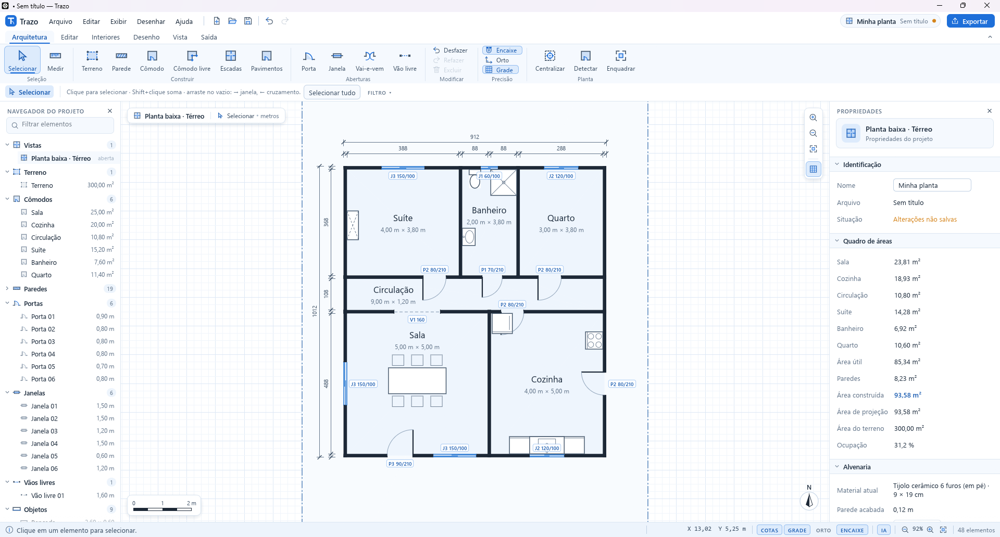
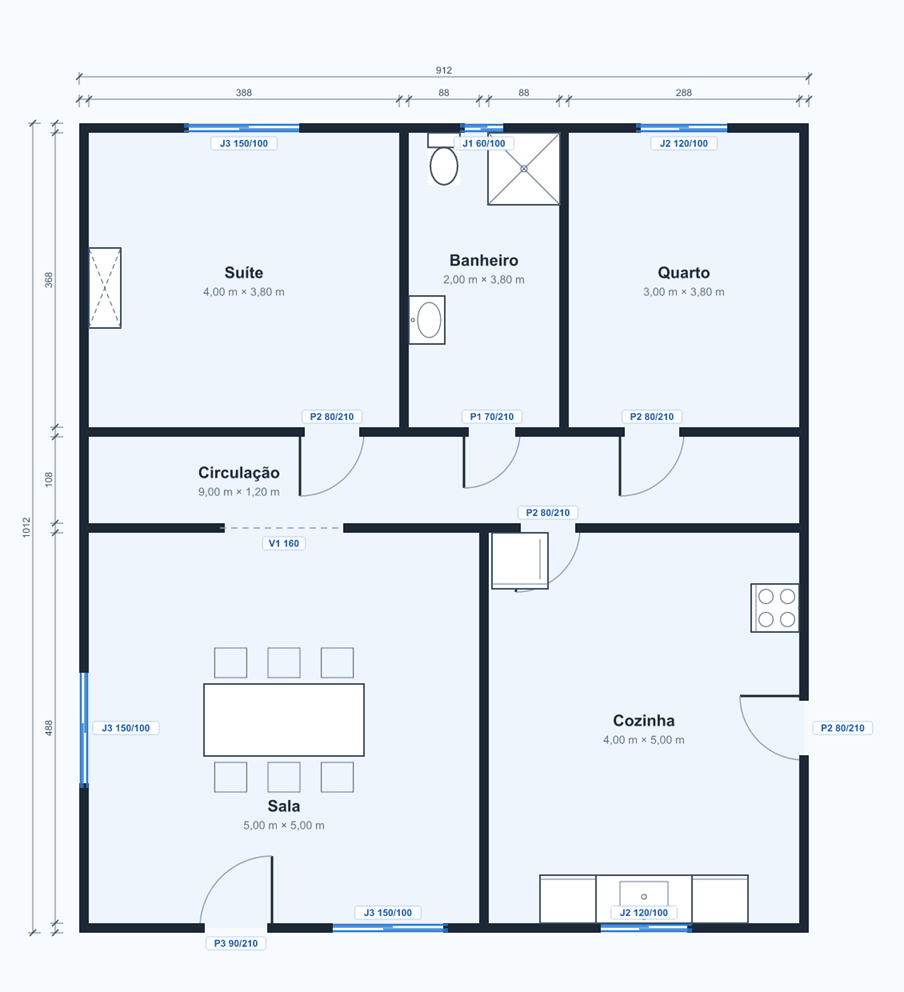
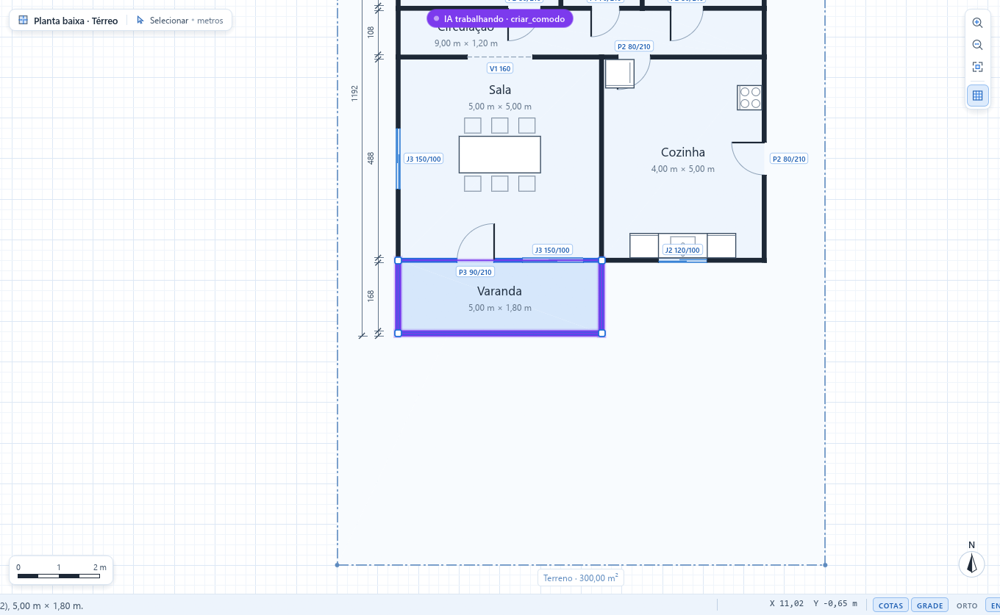

<div align="center">

# Trazo

**Planeje sua casa com mais segurança.**<br>
**A free tool that guides families with little money and no engineering training to plan their own house with a minimum of safety.**

[](https://github.com/igors93/Trazo/actions/workflows/ci.yml)
[](#license)
[](https://www.rust-lang.org)
[](docs/mcp.md)

[A proposta](docs/proposta.md) · [Who it is for](#who-trazo-is-for) · [How it works](#how-trazo-works) · [How it protects](#how-trazo-protects) · [Getting started](#getting-started) · [AI assistants](#ai-assistants) · [Documentation](#documentation) · [Roadmap](ROADMAP.md)

</div>

> **O Trazo existe para que a falta de dinheiro e de conhecimento técnico não deixe uma família completamente desamparada diante dos riscos de construir a própria casa.**
>
> *Trazo exists so that a lack of money and technical knowledge does not leave a family completely unprotected against the risks of building its own home.*

## Por que o Trazo existe

No Brasil, a maior parte das obras de moradia é feita sem engenheiro e sem arquiteto, principalmente nas favelas, nas periferias e nos bairros mais pobres. As ferramentas de projeto foram feitas para quem já sabe projetar; quem mais precisa de orientação fica sem nenhuma.

O Trazo não foi feito para o engenheiro que já sabe projetar. Ele foi feito para quem não sabe e vai construir mesmo assim: para orientar, avisar dos riscos, recusar decisões perigosas e mostrar quando é hora de parar e pedir ajuda, inclusive a assistência técnica gratuita a que famílias de baixa renda têm direito.

O centro do Trazo é uma conversa: um assistente de IA, conectado pelo MCP, faz o trabalho intelectual de projetar, comparar, revisar e organizar. O Trazo confere **e contesta** cada decisão da IA, inclusive as hipóteses que ela usou, e a família recebe orientações claras para construir, sem precisar aprender CAD ou engenharia para começar.

**Leia a proposta completa, em português: [A proposta do Trazo](docs/proposta.md).**



> [!NOTE]
> Trazo's interface is in **Brazilian Portuguese** and follows Brazilian standards (ABNT NBR 6118, NBR 5410, NBR 9050, NBR 6492). [The proposal](docs/proposta.md) is in Portuguese because it is written for the families Trazo protects; the technical documentation is in English for contributors anywhere. An English interface is on the [roadmap](ROADMAP.md) (#68).

## Who Trazo is for

**First, the people who build without a professional:**

- **families** building, extending or renovating their own home with little money and little technical knowledge;
- **bricklayers and site foremen** who build for their neighbours and want to check what they are about to do;
- **community leaders, self-help building groups (*mutirões*) and housing movements** following many works at once.

**Then, their allies:** engineers, architects and students who give technical assistance to these families. Trazo hands them an organised plan and a calculation report to review, which makes their help faster and cheaper.

Trazo is not built for the engineer who already knows how to design. Professionals are welcome and Trazo stays precise enough for them, but when a design decision has to choose between the family and the specialist, it chooses the family.

## How Trazo works

**MCP is Trazo's operational centre.** Nobody needs to learn CAD or engineering to start:

1. **The family describes the house** in plain Portuguese to an AI assistant connected to Trazo: the lot, the rooms, the budget, a future floor, whether the lot is on a slope or near a stream.
2. **The AI does the intellectual work.** Through MCP it draws the plan, compares alternatives, lays out the structure, runs every check, fixes what it can and organises the documents.
3. **Trazo checks and contests every AI decision** with deterministic, tested rules (see below).
4. **The family sees everything and decides.** Each AI step shows live on the plan, can be undone, and is never applied halfway.
5. **The family receives clear instructions to build:** what to do, in what order, with which materials, what to check before each pour, and when to stop and get help.

The drawing tools remain for anyone who wants to adjust by hand, and every check works the same with no AI connected.

### Trazo contests the AI

An AI that designs alone can call a simulation with **wrong hypotheses** (a firm soil nobody surveyed, a live load below the standard, a stronger concrete than the site will mix) and receive a result that **looks safe**. The essential condition of Trazo is that it can contest the AI's decisions:

- **The AI supplies inputs, never results.** Every check is computed by Trazo.
- **Every hypothesis has an origin:** Trazo's conservative default, data from the person (a soil survey, a specification) or the AI.
- **No evidence, no green.** A result that depends on a favourable hypothesis without evidence is shown as *contested*, never green.
- **Standards do not go down.** Minimum loads and the regional wind speed cannot be lowered.
- **Hypotheses need the person.** The AI may propose; the person confirms, with the evidence.
- **Independent cross-checks** contest a detailed simulation that disagrees with simple global checks.
- **Every AI action reports what it made worse.**

**Status:** Trazo computes every result itself, refuses what lies outside its methods' limits, records the origin and evidence of every hypothesis (#168), contests favourable hypotheses without evidence and values below the standards (#169), and keeps an assistant's favourable hypothesis changes as proposals until the person confirms them with evidence in *Segurança* (#171). Every AI action also reports what it made worse (#170), and an independent weighing of the house contests a simulation it disagrees with (#172). The rest of M0 is in the [roadmap](ROADMAP.md#m0-protection-for-self-builders).

## How Trazo protects

Trazo does not promise that a house will not fall. It does everything it can so that a family never takes a dangerous decision without knowing it is dangerous.

- **Draw without learning technical drawing.** Lot, rooms, walls, doors and windows with real measurements. Draw the house as you imagine it; Trazo takes care of walls, junctions and dimensions.
- **Every risky decision is checked.** Slabs, beams, columns, footings, tall walls, roofs, the water tank and the electrical installation.
- **A traffic light you can read.** Green passes with a margin, yellow passes at the limit, red cannot stay that way. Each result comes with one plain sentence on what to change: *"this beam is too shallow for its span: make it 40 cm tall"*.
- **It refuses what it cannot size safely.** More than three storeys, very long spans, heavy loads or very weak soil: Trazo gives no number, explains why and says a professional is needed.
- **The safe side when data is missing.** Without a soil survey Trazo assumes 100 kPa (1 kgf/cm²), without a specification C20 concrete, and while the city is unknown a wind speed of 45 m/s. Every result lists what it assumed, who set it and on what evidence.
- **The load path, made visible.** Slab to beam, beam to column, column to footing, footing to soil, on screen and on paper.
- **Plain words first, the full calculation one click away.** The family reads the sentence; the reviewing professional opens the formula, the standard and the assumptions.
- **A shopping list.** Blocks, cement, sand, steel and tiles with waste, so the money goes to the right material.
- **Ready for a professional's review.** The calculation report (*memorial*) in PDF gathers inputs, results and warnings, with a box for the reviewer's name, CREA or CAU registration and opinion.
- **Honest about its limits.** Trazo never claims to be an engineer, never issues an ART, RRT or permit, and says what it cannot see: the slope of the ground, a nearby stream, landfill, the quality of the concrete. Green is not a guarantee. **Red always means stop.**
- **Accessible.** Free, works without internet, runs on a modest computer, speaks Portuguese, and the files stay with the family.

## Features

<table>
<tr>
<td width="50%" valign="top">

**Safety checks (pre-sizing)**
- Traffic light with margins and one plain sentence per result
- Refusal outside each method's limits, with the reason
- Columns, beams, slabs, footings, ground beams and balance beams (NBR 6118, NBR 6122)
- Water tanks and heavy loads on slabs, lintels and sills, masonry panels (NBR 16868)
- Tall walls and roofs under wind, timber roofs and posts (NBR 6123, NBR 7190)
- Stairs, balconies and cantilevers; soil surveys and foundation comparison
- Calculation report (*memorial*) in PDF for a professional's review

**Drawing**
- Lots, walls and rooms with real measurements; L, U and free-shape rooms
- Object snaps, ortho mode and typed distances, angles and coordinates
- Copy, move, rotate, mirror, offset, trim, extend, divide, join
- Align, distribute, group and repeat; geometric constraints

**Architecture**
- Wall junctions at any angle; shared walls that move with both rooms
- Masonry with real bricks and blocks, modulation and block estimates
- Hinged, sliding, pocket, pivot, bifold and saloon doors; seven window types; gates
- Stairs, accessible ramps, landings, railings and multiple floors
- Irregular lots, setbacks, and usable, built and lot areas

</td>
<td width="50%" valign="top">

**Electrical installation (NBR 5410)**
- Outlets, switches, lights, distribution board and data points
- Minimum points per room generated from the standard
- Automatic circuits and a load schedule with current, wire gauge, breaker and RCD
- Conduits with wiring, phase balancing, voltage drop and single-line diagram

**Building materials**
- Construction quantities: blocks with waste, half blocks, lintels, mortar, plaster, finishes
- Bar schedule with a CA-50 summary by diameter
- Per-room finishes, baseboards and waterproofing

**Interiors and comfort**
- Furniture and fixtures that stand against the nearest wall face
- Circulation, door-swing and clearance checks (NBR 9050)

**Documentation**
- Dimension chains, door and window tags and schedules
- Sheets from A4 to A0 at exact scale, title blocks, sections and elevations
- Export to PDF, PNG, SVG, DXF and CSV

**Your work is safe**
- Atomic saves with a backup, crash recovery, and undo for every edit
- Several projects in tabs, side by side

</td>
</tr>
</table>

<p align="center">
  
  <br><em>A plan exported to PNG. Room labels move clear of furniture and door swings, on screen and on paper.</em>
</p>

## Getting started

### Download and run

Download a portable build from [GitHub Releases](https://github.com/igors93/Trazo/releases/latest). No installation of other software is needed.

- **Windows 10/11 (x64):** download `trazo-<version>-x86_64-pc-windows-msvc.zip`, extract the entire ZIP, then open `trazo.exe` inside the extracted folder. No installer or administrator privileges are required.
- **Linux (x64):** extract the `x86_64-unknown-linux-gnu.tar.gz` archive and run `./trazo`.
- **macOS:** extract the `aarch64-apple-darwin.tar.gz` archive for Apple Silicon, or `x86_64-apple-darwin.tar.gz` for Intel, and run `./trazo`.

The downloads are **unsigned community builds**. Windows SmartScreen or macOS Gatekeeper may warn or block execution. Compare the archive's SHA-256 hash with `SHA256SUMS.txt` from the same release using `Get-FileHash <archive> -Algorithm SHA256` (Windows), `sha256sum <archive>` (Linux) or `shasum -a 256 <archive>` (macOS). Checksums verify integrity, not publisher identity.

### Your first plan

1. **Terreno** (`T`): type the lot's width and length, for example 5 × 25 m.
2. **Cômodo** (`C`): drag a room and name it by its use (*Sala*, *Quarto*, *Cozinha*, *Banheiro*): the checks change with the kind of room. Its walls are created and joined to the existing ones.
3. **Porta** (`R`) and **Janela** (`J`): drag them onto a wall.
4. **Estrutura** tab: **Gerar estrutura** lays out columns, beams, slabs and footings over the walls.
5. **Segurança**: read the traffic light. Fix every red result before thinking about building, and read [when to stop and get help](docs/proposta.md#quando-parar-e-procurar-ajuda).
6. **Exportar memorial (PDF)**: take it, with the plan, to a professional or to free technical assistance.

The [user guide](docs/user-guide.md) covers every tool and shortcut.

### Build from source

Requirements: [Rust](https://rustup.rs) 1.85 or newer (stable). Windows 10 or 11 is the main platform; Linux and macOS builds should work but are less tested. On Debian or Ubuntu, first install `libxkbcommon-dev libgl1-mesa-dev libgtk-3-dev`.

```sh
git clone https://github.com/igors93/Trazo.git
cd Trazo
cargo run --release
```

## AI assistants

Trazo runs an MCP server while it is open, at `http://127.0.0.1:7799/mcp`. Connect Claude Desktop with one click, Claude Code with one command, or ChatGPT through a protected tunnel, then ask in plain Portuguese:

> *"Quero uma casa de dois quartos num terreno de 5 por 25 metros, com laje para fazer um andar em cima depois. Confere se a estrutura aguenta."*
>
> (*"I want a two-bedroom house on a 5 by 25 metre lot, with a slab to build a floor on top later. Check whether the structure holds."*)



- **The operational centre.** The assistant designs, compares, reviews and organises; the person does not need to know the commands.
- **Told to protect.** Trazo instructs every assistant that the person may have no engineering training: speak simply, never play down a red result or a refusal, never change a hypothesis (soil, concrete, loads) without evidence from the person, and point to a professional or free technical assistance when one is needed.
- **Contested by Trazo.** Instructions are not enough, so Trazo's own rules check every AI edit, and contesting the AI's hypotheses is the first item of the roadmap (see [Trazo contests the AI](#trazo-contests-the-ai)).
- **Live and visible.** Each AI edit flashes on the plan, and *Conectar uma IA* logs what the assistant did.
- **Safe to try.** Every tool call is one undo step, and failed calls change nothing.

See the [MCP guide](docs/mcp.md) for setup and the full tool list.

## Documentation

| Document | For |
| --- | --- |
| [A proposta do Trazo](docs/proposta.md) | Why Trazo exists, who it is for, how it protects and where it stops (in Portuguese, for everyone) |
| [User guide](docs/user-guide.md) | Every tool, workflow and keyboard shortcut |
| [Engineering methods](docs/engineering.md) | Every calculation: formula, standard, assumptions, limits and tests |
| [MCP guide](docs/mcp.md) | Connecting AI assistants, tools, real-time collaboration and security |
| [Architecture](docs/architecture.md) | How the code is organised, for contributors |
| [Roadmap](ROADMAP.md) | What comes next, milestone by milestone |
| [Changelog](CHANGELOG.md) | What has shipped |
| [Contributing](CONTRIBUTING.md) | How to set up, code style, tests and pull requests |
| [Security policy](SECURITY.md) | How to report a vulnerability, and the security model |

## Roadmap

The next milestone is **M0: Protection for self-builders**:

1. **Trazo contests the AI:** every hypothesis has an origin, no evidence means no green, standards cannot be lowered, and hypothesis changes need the person.
2. **Safe defaults:** every missing value takes the unfavourable side, starting with the soil pressure.
3. **From a description to a checked house:** the assistant designs, compares and reviews through MCP, and reports in plain language.
4. **A building guide:** clear, stage-by-stage instructions to build the checked house.
5. **Where to get help:** every red result and refusal points to free technical assistance (ATHIS) and the Defesa Civil.
6. **Site risks Trazo cannot see, building on top and building in stages.**

Read the full [roadmap](ROADMAP.md) for details and the order of work.

## Contributing

Contributions of all sizes are welcome: stories from real building sites, bug reports, ideas, plain-language text, documentation and code. Start with [the proposal](docs/proposta.md) and [CONTRIBUTING.md](CONTRIBUTING.md), and please follow the [Code of Conduct](CODE_OF_CONDUCT.md). To report a security problem, see [SECURITY.md](SECURITY.md).

## License

Trazo is licensed under either of

- [Apache License, Version 2.0](LICENSE-APACHE), or
- [MIT license](LICENSE-MIT)

at your option.

Unless you explicitly state otherwise, any contribution intentionally submitted for inclusion in Trazo by you, as defined in the Apache-2.0 license, shall be dual licensed as above, without any additional terms or conditions.

## Acknowledgements

Trazo is built on [egui and eframe](https://github.com/emilk/egui) for the interface, [resvg](https://github.com/linebender/resvg) and [svg2pdf](https://github.com/typst/svg2pdf) for export, [tiny_http](https://github.com/tiny-http/tiny-http) for the MCP server, and [serde](https://serde.rs) for project files.
