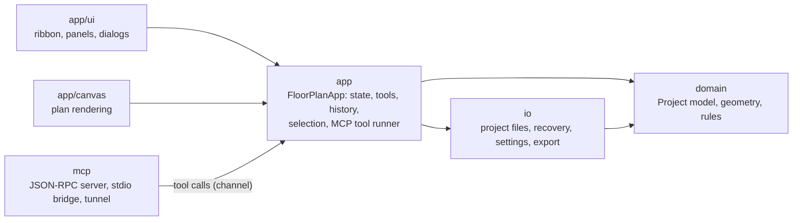

# Architecture

Trazo is a single Rust crate (edition 2024). It builds one native executable with no runtime services. This document maps the code for contributors.

Trazo exists so that a lack of money and technical knowledge does not leave a family unprotected against the risks of building its own home (see [the proposal](proposta.md)). Its first users have never studied engineering or used a CAD, and an AI assistant connected through MCP does the intellectual work of design for them. The architecture follows from that.

## Design principles

1. **MCP is the operational centre.** Every capability is reachable as an MCP tool that runs against the open project (`app/mcp_tools`). The interface is where the person sees, confirms and adjusts what the assistant did; a feature that only exists behind a button is unfinished.
2. **The domain contests the AI.** The assistant supplies inputs, never results: every check is computed by the deterministic rules in `src/domain` (`verdict`, `limits`, `structure`, …), which no tool can bypass. Hypotheses (soil, concrete, loads, wind) are inputs to contest, not to trust: recording their origin and refusing green for favourable hypotheses without evidence belongs in the domain too (rule 10 of the [safety contract](../ROADMAP.md#engineering-in-trazo-the-safety-contract), #168–#172).
3. **Protection before features.** Results show a traffic light and a plain sentence before the formula; outside a method's limits the domain refuses instead of extrapolating.
4. **Architecture, not just lines.** The model knows what a wall, a room and a door are and how they relate. Moving a wall between two rooms updates both rooms, their openings and the dimensions.
5. **One engine, one file.** Simple and advanced workflows edit the same project, with the same real measurements.
6. **The domain has no UI.** Everything in `src/domain` is plain Rust with no egui types, so the canvas, the exporters and the AI tools share the same rules. The room-label placement in `domain/label_layout.rs` is an example: one rule serves both the screen and the PDF.
7. **Every edit is transactional.** Changes run on a copy of the project; if a rule rejects the result (an overlap, a broken constraint, the buildable limit), the copy is dropped and the project is untouched.
8. **Code in English, interface in Portuguese.** Identifiers, comments and technical docs are in English (the proposal, `docs/proposta.md`, is in Portuguese for the families it is written for); text shown to users and returned by MCP tools is in Brazilian Portuguese.

## Layers



- **`domain`** owns the `Project` and every architectural rule. It never touches files, windows or the network.
- **`app`** is the egui application (`FloorPlanApp`): tools, interaction, selection, undo history and the canvas.
- **`io`** reads and writes project files, the recovery draft, settings, and exports (SVG, then PDF and PNG).
- **`mcp`** runs the MCP server on background threads. Tool calls reach the UI thread through a channel and run in `app/mcp_tools.rs`, so the AI edits exactly the project the person sees.

## Source map

### `src/domain`

| Module | Responsibility |
| --- | --- |
| `geometry.rs`, `geometry/` | `f64` points, distances, projections, polygons (ear-clipping triangulation), interior boxes; property tests in `geometry/property_tests.rs` |
| `model.rs` | `Project`, lot, walls, rooms, openings and fixtures, with validation and core operations |
| `model/` | Element picks and bulk edits (`elements`), copy/paste fragments (`fragment`), offset/trim/extend (`modify`), divide/join/align/distribute/repeat (`arrange`), groups, constraints and their solver, shared walls, room detection (`auto_rooms`), vertices, lot subdivision (`site`), drawings, and change sets for MCP revisions (`changes`) |
| `element.rs` | References to elements, element kinds and the selection filter |
| `junctions.rs`, `wall_reference.rs`, `wall_layers.rs`, `masonry.rs` | Wall junctions at any angle, axis/face references, multilayer walls, bricks and blocks, modulation and block estimates |
| `openings.rs`, `annotations.rs`, `dimensions.rs` | Door and window types, schedules and tags, dimension chains, associative dimensions |
| `fixtures.rs`, `library.rs` | Fixture kinds, sizes and plan symbols; the customisable furniture and symbol library |
| `label_layout.rs` | Where room labels go, clear of furniture, door swings and electrical tags (shared by canvas and export) |
| `electrical.rs` | Electrical devices, NBR 5410 load forecast, point generation, circuit distribution and sizing, device tags |
| `areas.rs`, `finishes.rs`, `schedules.rs`, `setbacks.rs` | Area summary, per-room finishes, configurable schedules, setbacks and buildable limit |
| `circulation.rs`, `ergonomics.rs`, `floors.rs` | Stairs, ramps and level changes; circulation and clearance checks; floors and levels |
| `layers.rs`, `hatch.rs`, `notes.rs`, `doc_style.rs` | Layers, hatch patterns, texts and symbols, ABNT documentation styles |
| `sheet.rs`, `sheet_set.rs`, `views.rs`, `templates.rs` | Sheets and scales, sheet sets and revisions, sections and elevations, project templates |
| `transform.rs`, `curves.rs`, `offset.rs`, `drawing/`, `snap.rs` | Transforms, curve intersections, offsets, 2D drafting entities and splines, object snaps |
| `history.rs` | Undo/redo stack of project snapshots, with duplicate-state suppression |

### `src/app`

| Module | Responsibility |
| --- | --- |
| `mod.rs` | `FloorPlanApp` state and the frame loop; its methods live in `lifecycle.rs` (startup, MCP, settings), `documents.rs` (new, open, save, close), `exports.rs`, `creation.rs`, `properties.rs`, `selection_rules.rs`, `undo.rs`, `edit_commands.rs`, `terrain.rs`, `viewport.rs` and `shortcuts.rs` |
| `interaction.rs` | Canvas mouse input: drawing state machine, picking, dragging, snapping, context menu |
| `selection.rs` | Multiple selection, window and crossing boxes, select similar and inverse |
| `tools/` | Drawing tools, free-shape rooms, typed numeric input, modify, arrange and constraint tools |
| `canvas.rs`, `canvas/` | Rendering of the plan, labels, overlays (scale bar, north arrow, crosshair, snap markers) and drafts |
| `ui/` | Menu bar, ribbon, options bar, project browser, properties, status bar, dialogs, icons and shared widgets |
| `theme.rs` | Colours, spacing, system fonts with symbol fallbacks |
| `mcp_tools.rs`, `mcp_tools/` | Trazo's operational centre: the MCP tools, run against the open project through the same transactional edits as the interface; argument parsing, one file per tool family, batches and CAD editing tools |
| `ai_activity.rs`, `plan_sync.rs` | Live highlight and log of AI actions; plan revisions and change notifications |

### `src/io` and `src/mcp`

| Module | Responsibility |
| --- | --- |
| `io/project_file.rs` | Atomic save with `.trazo.bak`, versioned schema and migrations |
| `io/recovery.rs`, `io/settings.rs` | Crash-recovery draft; interface preferences |
| `io/instance.rs` | Window slots (an OS file lock each): per-window recovery draft and MCP port |
| `io/export.rs`, `io/export/` | SVG generation (plan, labels, drawings, sheets), PDF via `svg2pdf`, PNG via `resvg`, CSV schedules |
| `mcp/protocol.rs` | JSON-RPC handling, the tool catalogue and the server instructions that tell every assistant how to treat a family without engineering training |
| `mcp/server.rs` | Streamable HTTP endpoint (`tiny_http`) and the event stream |
| `mcp/bridge.rs` | `--mcp-stdio`: relays stdio clients to the window's server |
| `mcp/events.rs` | Broadcasts plan-change notifications to open streams |
| `mcp/clients.rs`, `mcp/tunnel.rs` | Claude Desktop setup; Cloudflare quick tunnel with a per-session token |

## Frame forces and beam reinforcement

`domain/frame2d/builder.rs` retains an ELU envelope for each physical beam ID,
including the governing positive moment, negative moment and shear combinations.
`domain/reinforcement/design.rs` consumes these already factored forces directly;
it does not apply a second load factor or substitute the traditional beam moments.
The steel assumed by the existing Branson service deflection check remains an
explicit lower bound, exposed separately from the ultimate demand.
Frame-designed beams use continuous top bars for the full negative envelope, and
the schedule counts that run once. The UI, MCP and reinforcement sheet expose the
force source and governing combinations. Beams outside a column-supported frame
retain the characteristic continuous-beam sizing path. Other reinforcement types
retain their existing preliminary methods.

An unresolved frame prevents reinforcement issuance. An eligible beam missing its
frame envelope cannot silently fall back to the traditional analysis. Pinned joints
with pinned bases are rejected as a lateral mechanism: roof or masonry checks alone
do not add a physical bracing restraint to the frame model.

## Coordinates and units

- The model stores metres in `f64`, with **Y growing downwards** (screen orientation).
- People and AI assistants see **Y pointing up**; the MCP layer converts with `to_model(x, y) = (x, -y)`.
- Screen transforms live in `canvas::ViewTransform` (`scale` in pixels per metre, `pan` in pixels).

## Project files

Projects are JSON produced by `serde`. `io/project_file.rs` writes to a temporary file and renames it over the old one, keeping a `.trazo.bak`. Older schemas are migrated on load, and migrations are covered by tests. New fields must use `#[serde(default)]` so older files keep opening.

## Quality gates

CI ([.github/workflows/ci.yml](../.github/workflows/ci.yml)) runs on every push and pull request:

```sh
cargo fmt --all -- --check
cargo clippy --all-targets --all-features -- -D warnings
cargo test --all-targets --all-features
```

Unit tests live next to the code they test (`#[cfg(test)] mod tests`). Geometry uses `proptest` property tests. UI behaviour is tested by driving `FloorPlanApp` directly, for example running MCP tools and checking the project and the undo history.
