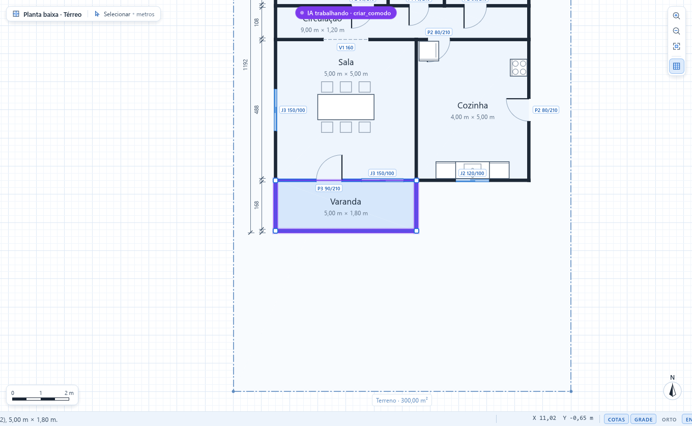
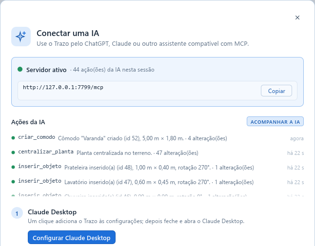

# Working with AI assistants (MCP)

Trazo includes a [Model Context Protocol](https://modelcontextprotocol.io) server. Claude, ChatGPT and any other MCP client can read and edit the plan that is open on screen from plain instructions, such as *"create a 12 × 20 m lot with a 6 × 5 m living room and a door on the left wall"*.

Everything the assistant does appears live in the window. Each tool call is one undo step, so `Ctrl+Z` takes it back.



- [How it works](#how-it-works)
- [Connecting a client](#connecting-a-client)
- [Tools](#tools)
- [Working together in real time](#working-together-in-real-time)
- [Conventions](#conventions)
- [Security](#security)
- [Troubleshooting](#troubleshooting)

## How it works

The server starts together with the window at `http://127.0.0.1:7799/mcp`, using the streamable HTTP transport. The **IA** switch in the status bar shows whether it is running; clicking it, or **Conectar IA** on the *Saída* tab, opens the *Conectar uma IA* (connect an AI) panel, which has everything below ready to copy.



- Keep Trazo open while the assistant works. Only one Trazo window serves MCP at a time.
- Each Trazo window serves its own project: the first on 7799, the next ones on 7800, 7801 and so on. An assistant can connect to several windows to work on more than one project.
- Set the `TRAZO_MCP_PORT` environment variable to change the first port.
- Every change runs on a copy of the project and is applied only if it succeeds. A failing tool explains why, so the assistant can correct itself.

## Connecting a client

| Client | How to connect |
| --- | --- |
| **Claude Desktop** | Click **Configurar Claude Desktop** in *Conectar uma IA*. Trazo is added to `claude_desktop_config.json`, keeping your other settings and a `.bak` copy. Restart Claude Desktop. |
| **Claude Code** | `claude mcp add --transport http trazo http://127.0.0.1:7799/mcp` |
| **ChatGPT, Claude on the web** | These run in the cloud and need a public HTTPS address; see [Cloud assistants](#cloud-assistants). |
| **Any stdio client** | Run `trazo --mcp-stdio` (see below). |

### Claude Desktop by hand

```json
{
  "mcpServers": {
    "trazo": {
      "command": "C:\\path\\to\\trazo.exe",
      "args": ["--mcp-stdio"]
    }
  }
}
```

In stdio mode Trazo has no window of its own. It relays to the window's server, and opens the window by itself on the first tool call.

### Cloud assistants

**Abrir túnel** (open tunnel) in *Conectar uma IA* starts a free Cloudflare quick tunnel with `cloudflared`, which the same panel can install with winget. Copy the connector address it shows: `https://….trycloudflare.com/mcp/<token>`. The secret token in the path is created anew each time the tunnel opens.

Create a connector with that address and no authentication; in ChatGPT this is done in developer mode. The tunnel closes when you close it or quit Trazo.

## Tools

Trazo exposes 62 tools. Their names and messages are in Portuguese, like the interface.

| Group | Tools |
| --- | --- |
| **Reading** | `obter_planta` (the plan: ids, coordinates, sizes, areas, setbacks, wall thickness/material/heights, opening codes/typologies, finishes, structural & documentation summary, groups, constraints, selection and revision), `imagem_da_planta` (a PNG preview), `mudancas_desde` (what changed since a revision) |
| **Lot and walls** | `definir_terreno` (size, origin and building setbacks `recuo_frente`/`recuo_fundos`/`recuo_lateral`), `criar_parede`, `editar_parede` (length, and the wall's own height: `altura_m`, `altura_fim_m` for a sloped top, `altura_padrao`), `definir_alvenaria` (brick or block, joint, plaster, ceiling height) |
| **Rooms** | `criar_comodo` (rectangle or any polygon), `editar_comodo` (rename, resize, finish presets and per-room floor/wall/ceiling/baseboard/waterproofing specifications) |
| **Openings** | `inserir_abertura` (door, window, saloon door, open span or gate), `editar_abertura` (width, position, height, sill, door/window typology `tipo_porta`/`tipo_janela`, side and hinge) |
| **Electrical (NBR 5410)** | `inserir_ponto_eletrico` (outlets, switches, lights, panel, data), `editar_ponto_eletrico` (circuit, power, height), `projeto_eletrico` (generate the minimum points, distribute circuits, set the voltage, lay conduits with `gerar_eletrodutos`, join two points with `ligar_pontos`, move a run to the floor with `definir_trecho`, delete one with `remover_eletroduto`, choose the supply with `definir_alimentacao` and utility profile with `definir_concessionaria`), `quadro_de_cargas` (forecast, circuits with phases, voltage drop, wire and breaker, demand, service entrance, the wires of each conduit, warnings) |
| **Structure (pre-sizing)** | `projeto_estrutural` (lay out the structure with `gerar_estrutura`, place columns/footings, add/edit/remove water-tank or equipment point loads with `inserir_carga`/`editar_carga`/`remover_carga`, join columns or support secondary beams, edit beams/slabs, configure materials/masonry weight/per-room loads and 2D frame joint/base fixity `portico_nos_rigidos`/`portico_bases_engastadas`, toggle plan/paper overlays with `configurar_sobreposicao`, run What-if scenarios with `simular_whatif`, resize footings, generate/edit balance beams and wall ground beams/strip footings, define SPT `definir_sondagem`/`remover_sondagem` and `simular_fundacoes`, timber roofs `definir_telhado` (`estilo`: `meia_agua`/`duas_aguas`/`quatro_aguas`, `beiral_m`, `tesouras`) / `ajustar_paredes_telhado` / `remover_telhado`, timber posts `inserir_mourao` with species/class and treatment, NBR 6123 wind `configurar_vento`, and select a discipline), `pre_dimensionamento` (slabs with rectangular panels, Czerny/Marcus moments and deflection, continuous beams with Branson B12 cracked-section `Mr`/Stage I-II/`I_eq/Ic`, 2D plane frames `porticos_2d` coupling beams and columns with column moments, reactions and lateral drift, explicit solver failures in `falhas_porticos_2d` with frame label and reason, columns with slenderness, footings, wall foundations, lintels/sills and infill/load-bearing masonry panels, balance beams, roofs with wall plates/Howe trusses/hip rafters/overhangs/uplift, timber posts with compression/buckling/wind interaction and durability, NBR 6123 wind checks, soil survey, comparative foundation study, preliminary reinforcement with NBR 6118 anchorage/laps, bar schedule and CA-50 summary by diameter with 12 m bars and +10% waste, safety lights and warnings) |
| **Quantities & ergonomics** | `quantitativos` (consolidated takeoff for active floor or `todos_pavimentos: true` with optional `perda_blocos_pct`: masonry blocks/half-blocks, bond-beam & lintel U-blocks with waste, laying mortar, plaster, grout fill, lintels/sills with opening codes `P1`/`J1`, per-room finishes +10% waste/waterproofing/specs, per-floor summary, roof timber/tiles and preliminary steel mass), `ergonomia` (NBR 9050 & residential collision, door-swing, clearance and narrow-passage checks) |
| **Documentation & circulation** | `camadas` (CAD layers: list, create, edit, delete, assign), `anotacoes` (texts, notes, leader callouts, north/level/slope/entry symbols), `cotas` (associative internal room dimensions, automatic opening dimension chains `gerar_aberturas`/`gerar_completas`, wall-aligned and external dimensions), `circulacao` (stairs with Blondel check, NBR 9050 ramps, landings, railings, level changes), `vistas_tecnicas` (sections, facade elevations, detail callouts and SVG/PDF export), `prancha` (ABNT sheet size, orientation, scale, title block and sheet-set release) |
| **Fixtures and drawing** | `inserir_objeto` and `editar_objeto` (position, 90° or free `angulo_graus`, size, optionally against the nearest wall), `desenhar` (lines, polylines, rectangles, arcs, circles, splines) |
| **CAD editing** | `selecionar` (shows the person which elements the assistant means), `mover_elemento`, `transformar` (move, rotate, mirror or copy several elements), `alinhar`, `distribuir`, `agrupar`, `desagrupar`, `repetir` (grid or polar), `editar_geometria` (trim, extend, offset, divide), `unir`, `restringir`, `remover_restricao`, `excluir_elemento` |
| **Batch** | `executar_lote`: up to 200 tool calls in one request, all or nothing, as a single undo step |
| **History and view** | `desfazer`, `refazer`, `centralizar_planta` |
| **Synced views, floors & dependencies** | `abas` (list projects and linked tabs, switch, open linked discipline views `nova_visao`, configure view, split side-by-side, close, duplicate), `pavimentos` (list, add or switch floors), `dependencias` (cross-discipline dependency graph, last auto-sync report and manual-review items) |
| **Files & exports** | `novo_projeto`, `abrir_projeto`, `salvar_projeto`, `exportar_planta` (`pdf`, `pdf_abas`, `png`, `dxf`, `svg`, `prancha_pdf`/`prancha_pdf_abas`/`prancha_svg`, `memorial_pdf`, `unifilar_svg`/`unifilar_pdf`, `esforcos_svg`/`esforcos_pdf`, `porticos_svg`/`porticos_pdf`, `grelha_svg`/`grelha_pdf`, `armaduras_svg`/`armaduras_pdf`, `quantitativos_csv`/`quantitativos_svg`/`quantitativos_pdf` with optional `todos_pavimentos`, `tabela_aco_csv`, `csv`), `importar_dxf` |

Tools that only read are marked read-only. Tools that mix reads and edits are marked as mutations. `executar_lote` cannot contain file/history tools, `biblioteca`, `blocos`, `referencias`, `documentacao` or `modelos`, because these groups can also change files or the shared personal library. Project mark edits, `acabamentos` and `terreno` can participate in atomic batches.

### Review marks and project resources

| Tool | Coverage |
| --- | --- |
| `obter_marcacoes` | Read-only mark query, including hidden/resolved marks; filter by numeric id, exact colour, resolved state and floor, or use `todos_pavimentos`. Returns `referencia` (`M12`), colour, comment, geometry in metres with Y up, bounds, floor, explicit references and geometrically related elements. |
| `marcacoes` | `criar`, `editar`, `mover`, `excluir`, `resolver`, `reabrir`, `selecionar`, `configurar`, or `listar`. A rectangle uses two corners, a circle uses centre/radius point, an arrow uses its ends and freehand uses 2–2048 points. Comments allow 4000 characters. Mutations apply to the active floor; optional `pavimento_id` protects against editing another floor. |
| `biblioteca` | Search/list built-in, project and personal models; create/edit/delete custom models, insert with their real dimensions/rotation, or share to the personal library. Always pair `origem` with `id`. |
| `blocos` | List project/personal definitions and placed instances; define a block from selected ids, insert with attribute overrides, edit instance attributes, share or delete a definition. |
| `referencias` | Images/PDF/SVG underlays with import, geometry, opacity, visibility, locking and two-point calibration; external Trazo/DXF references with reload; compare against a file or tab, show/clear the visual overlay and export the comparison SVG. |
| `documentacao` | Read actual schedule tables/style settings; configure pens, font, units, dimension ticks, schedule visibility and waste; add revisions, update/remove/reorder sheets and export the CSV transmittal. Updating a released sheet invalidates its previous release review. |
| `modelos` | List built-in templates, examples and personal `.trazot` templates; apply with an unsaved-changes guard or save a new template without rebinding the current project file. |
| `acabamentos` | List/apply room hatches, spacing, angle and colour; list/apply/clear wall assembly presets or define explicit layers with roles, thicknesses and colours. |
| `terreno` | Read polygon boundaries/lots, define a polygonal site, subdivide by a line, rename/remove lots. Rectangular sites and setbacks remain available through `definir_terreno`. |

The existing `pavimentos` tool also edits/removes floor metadata and controls the floor-below reference. `circulacao` and `vistas_tecnicas` accept `acao: "editar"` to update placed elements without deleting/recreating their ids. All tools are listed by `tools/list` with their arguments.

Example mark creation:

```json
{
  "acao": "criar",
  "tipo": "retangulo",
  "cor": "vermelho",
  "comentario": "Rever a disposição dos armários",
  "pontos": [{"x": 1, "y": 2}, {"x": 4, "y": 5}]
}
```

`obter_planta` includes the active floor's marks, `marcacao_selecionada` and a resource summary. `mudancas_desde` includes `marcacoes_adicionadas`, `marcacoes_removidas` and `marcacoes_alteradas`. `imagem_da_planta` includes visible marks by default; use `incluir_marcacoes: false` for a clean preview. File exports follow the saved mark export setting instead.

Project changes use undo/recovery and linked views. Personal-library and file writes are persistent external operations and do not belong to project undo. Comments are project data; creating a mark does not execute its text or authorize an assistant to change the referenced elements.

`pre_dimensionamento` now includes `alvenaria.paineis[].vento_fora_plano` with wind demand/capacity, proposed intermediate/crown ties and `jambas_aberturas[]` (grouted vertical concrete jambs beside openings in tall walls), and `fundacao_paredes[]` with signed reactions to columns and receiving ground beams. `projeto_estrutural` with `configurar_vento` also returns the tall masonry-panel effects under `paineis_alvenaria`. A missing support path is exposed as `apoios_insuficientes` and a red verdict.

`projeto_estrutural` with `definir_telhado` accepts `contraventamento_kn` as the verified design resistance of the full lateral path (or `null` to remove it). `configurar_vento` and `pre_dimensionamento` return `vento.pilares[]` (including footing wind eccentricity/pressure `sapata_excentricidade_m`, `sapata_pressao_max_kpa`, `sapata_vento_uso`), `vento.telhados[]` (with NBR 8800 anchor bolts `chumbador_mm`, `chumbadores_qtd`, `chumbador_interacao`, `chumbadores_sugeridos`), `vento.contraventamento` (with CA-50 X-bracing tie rod `tirante_mm`, `tirante_as_cm2`, `tirante_sugerido`) and `vento.estabilidade_global` with four directional checks including NBR 6122 soil sliding (`atrito_mu`, `resistencia_deslizamento_kn`, `deslizamento_fs`). Roof bearing alone never counts as top lateral restraint.

`pre_dimensionamento` also returns `cargas_e_combinacoes` (`nbr_6120` with `G1`/`G2`/`Q` totals, per-room Table 10 live loads and occupancy `ψ0/ψ1/ψ2`; `vento_edificacao_nbr_6123` with four orthogonal directions, Table 4 `Cpe`/`Ca`, storey-by-storey forces and `ELU-EQU` overturning; `combinacoes_nbr_8681` with all 17 ELU/ELS combinations and resultants), `sobreposicao_planta` (active on-plan/paper simulation overlays), `grelha_lajes_vigas` (coupled 3-DOF slab + beam grillage analysis including L-shaped/irregular slabs, `mx/my/mxy`, deflections, beam torsion and equilibrium residual), `escadas_e_balancos` (concrete stairs, balconies and cantilever slabs/beams with NBR 6118 `γ_n`, `L/125` deflection, top negative steel and `1.5·L_bal` back-span checks; add/remove explicit cantilevers via `projeto_estrutural` → `definir_balanco`/`remover_balanco`), and enriches every `porticos_2d[]` entry with `vento_caracteristico_kn`, `casos_de_carga`, `combinacoes`, `envoltoria_elu` (including `arrancamento_pilar`) and `envoltoria_els`. Use `projeto_estrutural` → `configurar_sobreposicao` to toggle utilisation colours, beam diagrams, deformed shape and load path on screen and exported sheets, and `projeto_estrutural` → `simular_whatif` to test span/section/load/material variations with safe-range bands (optionally setting `aplicar: true`). Setting `ocupacao` via `projeto_estrutural` → `configurar` updates both the base live load and the NBR 8681 combination factors.

## Working together in real time

You and the assistant can edit the same plan at the same time without overwriting each other.

- **Live highlight.** Every element the assistant adds or changes flashes with a purple outline, and a badge names the tool at work. With *Acompanhar a IA* (follow the AI) on, the view slides to edits that happen off screen, keeping your zoom. *Conectar uma IA* lists the assistant's recent actions.
- **Revisions.** Every change to the plan gets a revision number: yours or the assistant's, including undo and redo. `obter_planta` returns the current `revisao`. `mudancas_desde` tells the assistant what changed after the revision it knows: who did it (`usuario` or `ia`, with the tool) and which element ids were added, removed or altered.
- **Notifications.** The open plan is the MCP resource `trazo://planta` (`resources/read`). A client that subscribes and opens the event stream (`GET /mcp` with `Accept: text/event-stream`, also relayed by `--mcp-stdio`) receives `notifications/resources/updated` the moment the plan changes. *Conectar uma IA* shows how many assistants are following the plan live.

## Conventions

- Coordinates are in metres with **Y pointing up**, as in the status bar.
- Files saved or exported without a full path go to `Documents\Trazo`.
- `prancha` supports `listar_conjunto`, `adicionar_ao_conjunto`, `definir_situacao` and `exportar_conjunto`. To set `situacao: "liberado_obra"` while there are red checks, provide `id`, `revisor`, `registro_revisor` (numbered CREA/CAU) and `data_revisao`. A changed red result or sheet revision invalidates that release in exports.
- Opening or creating a project refuses to drop unsaved changes unless the assistant explicitly asks to discard them.

## Security

For ease of use, the local server has no authentication. It only listens on this computer (`127.0.0.1`).

While a tunnel is open, anyone who knows its full address, including the secret token, can read and edit the open plan and save or export files. Close the tunnel when you are done. See [SECURITY.md](../SECURITY.md) for how to report a vulnerability.

## Troubleshooting

| Problem | Fix |
| --- | --- |
| The **IA** switch is off | Another program is using this window's port (7799 for the first window, 7800 for the second…). Close it, or start Trazo with a different `TRAZO_MCP_PORT`. |
| Claude Desktop does not list Trazo | Restart Claude Desktop after configuring it, and check that the path in `claude_desktop_config.json` points to the current `trazo.exe`. |
| `cargo build` fails with "access denied" on Windows | Claude Desktop is running `trazo.exe --mcp-stdio`, and Windows locks the running executable. Close Claude Desktop, then rebuild. |
| The cloud assistant cannot connect | Check that the tunnel is still open and that you copied the full address, including `/mcp/<token>`. |
