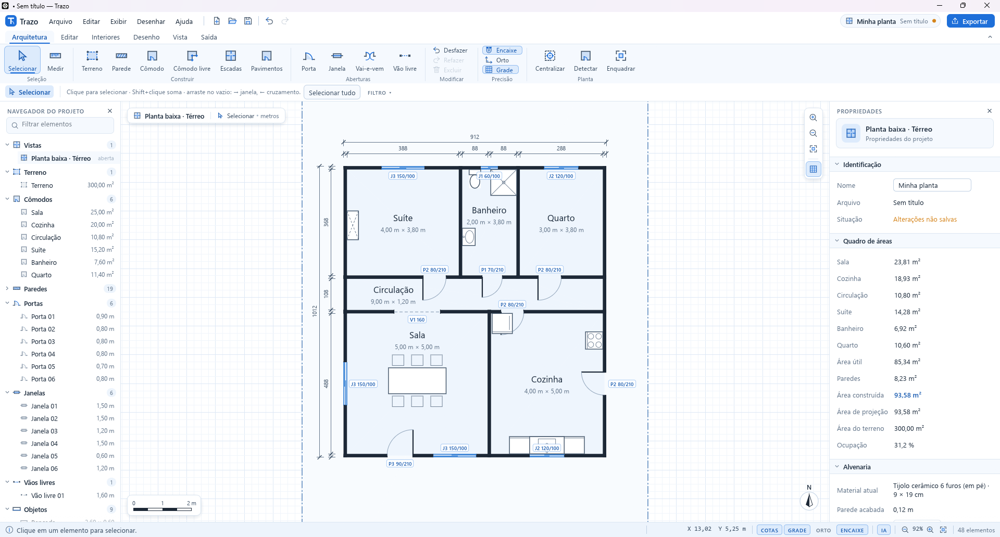
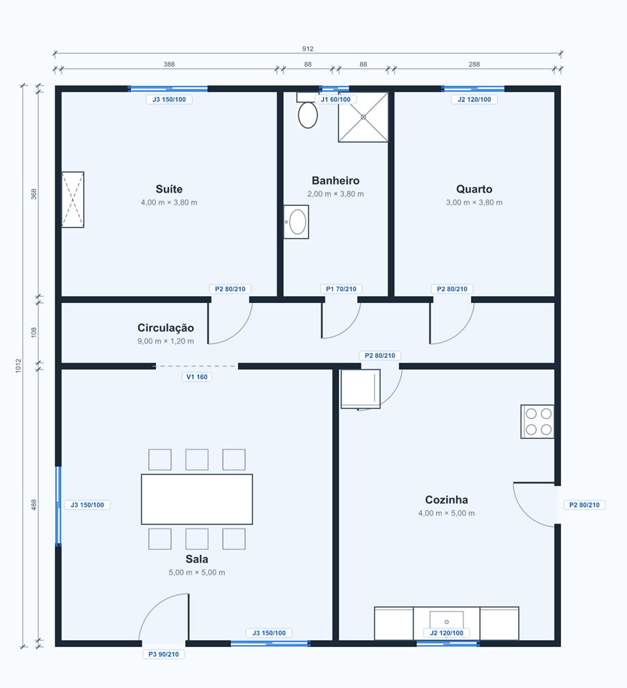

# User guide

This guide walks through Trazo's interface and workflow. The application interface is in **Brazilian Portuguese**; every label below is quoted as it appears on screen, followed by its English meaning the first time it shows up.

- [The workspace](#the-workspace)
- [Drawing a plan](#drawing-a-plan)
- [Selecting and editing](#selecting-and-editing)
- [CAD modify tools](#cad-modify-tools)
- [Architecture tools](#architecture-tools)
- [Interiors](#interiors)
- [Electrical design](#electrical-design)
- [Structure](#structure)
- [Discipline views](#discipline-views)
- [Documentation and output](#documentation-and-output)
- [Files and data safety](#files-and-data-safety)
- [Keyboard and mouse](#keyboard-and-mouse)

Conventions: lengths are in metres, Portuguese decimal commas are accepted in every field (`3,47`), and coordinates use **Y pointing up**, as in the status bar.

## The workspace

| Area | What it holds |
| --- | --- |
| **Menu bar** | *Arquivo* (File), *Editar* (Edit), *Exibir* (View), *Desenhar* (Draw) and *Ajuda* (Help), each entry with its icon and shortcut; quick buttons for new, open, save, undo and redo; the project name with a dot that marks unsaved changes; and **Exportar** (Export). |
| **Ribbon** | Six tabs: *Arquitetura* (architecture), *Editar* (edit), *Interiores* (interiors), *Desenho* (2D drafting), *Vista* (view) and *Saída* (output). Click the active tab, or the arrow at the right, to fold the ribbon and gain drawing space. |
| **Options bar** | The active tool and its settings: the lot's exact width and length, the wall material and block size, the modulation switch, the default door width, the selection filter, and so on. |
| **Project browser** (left) | Views, lot, rooms, walls, doors, windows, open spans, fixtures, drawings, groups and constraints, with areas and lengths. A text filter, foldable groups, click to select, double-click to zoom to an element. Empty categories stay as quiet one-line rows. |
| **Properties** (right) | Foldable sections for the selected element (dimensions, masonry, frame type, finishes, location, relations). With nothing selected: the area schedule, the door and window schedule, the masonry estimate, the occupancy rate and the view settings. |
| **Plan view** | Hover highlight, a CAD crosshair while drawing, snap markers, live dimensions, dimension chains, door and window tags, graphic scale, north arrow and a floating zoom bar. Right-click opens a context menu. |
| **Status bar** | Messages, cursor coordinates, the *COTAS* (dimensions), *GRADE* (grid), *ORTO* (ortho) and *ENCAIXE* (snap) switches, the *IA* (AI) server status, zoom and element count. |

Grid, snapping, ortho mode, modulation, dimension chains, open panels and the folded ribbon are remembered between sessions.

## Drawing a plan

### 1. The lot

Choose **Terreno** (lot, `T`), type the exact width and length (for example 12 m × 25 m) and click **Criar terreno** (create lot), or drag it on the canvas, or click two opposite corners. Lots can also be irregular polygons with sloped boundaries, and they can be subdivided. In Properties, **Recuos e limite de implantação** (setbacks and buildable limit) sets front, side and rear setbacks; Trazo then shows the buildable area and refuses edits that leave it.

### 2. Walls

Choose **Parede** (wall, `P`) and drag, or click the two ends. Snapping to the grid (0.25 m), wall ends, midpoints, intersections, perpendiculars, tangents, centres and extensions (**OSNAP**) helps precision; ortho mode (`F8`) keeps walls horizontal or vertical. While drawing you can type a length, an angle or coordinates (`@dX;dY`, `3<45`).

- **Masonry.** In the options bar pick the brick or block: ceramic bricks 9×19, 11.5×19, 14×19 and solid 10×20; structural ceramic block 14×29; concrete blocks 9, 14 and 19 × 39. Or type the two plan dimensions, joint and plaster in cm. Walls are drawn with their real finished thickness (block plus plaster on both faces).
- **Multilayer walls.** A wall can be built from layers (masonry, render, insulation, finish), each with its own thickness and material.
- **Reference line.** Walls can be placed by their axis, inner face or outer face.
- **Modulation** (*Modulação*). When on, wall lengths and room sides snap to half-block modules (length + joint), so walls close with whole and half blocks. Properties show each wall's first course and, for the project, the wall area and a block estimate for the chosen ceiling height, net of openings.
- **Junctions.** L, T and X junctions are mitred automatically, at any angle and with different thicknesses.

### 3. Rooms

- **Cômodo** (room, `C`): drag or click two corners, then name the room. Its four walls are created and joined to the walls already there; walls in line with existing ones are shared, never duplicated.
- **Cômodo livre** (free-shape room): click the corners of an L, U or any polygon.
- **Detectar** (detect): finds rooms automatically from walls that already enclose a space.

Moving a wall between two rooms updates both rooms, their doors and windows and the dimensions; nothing has to be redrawn. Vertices of free-shape rooms can be dragged directly.

### 4. Doors and windows

Drag **Porta** (door, `R`) or **Janela** (window, `J`) from the ribbon onto a wall, or pick the tool and click a wall; the wall that will receive it is highlighted. A door swings towards the side you clicked.

- **Door types:** hinged, double, sliding, pocket, pivot, bifold and revolving; **Vai-e-vem** adds double-acting saloon doors.
- **Window types:** sliding, top-hung (*basculante*), awning (*maxim-ar*), casement, tilt-and-turn, fixed and bay, each with its technical plan symbol.
- **Vão livre** (open span) leaves an opening with no frame.
- **Portão** (gate) goes in a boundary or front wall: 3.00 m sliding by default, from 0.80 m (pedestrian gate) to 8 m (vehicle gate). In Properties choose sliding, swing, double, pivot or folding. Gates are tagged "PT1 300/220".
- Openings keep a minimum distance from wall ends and never overlap. In Properties set width, height and, for windows, the sill; turn a door to the other side of the wall (`I`) or move its hinge to the other jamb (`Shift+I`).

### 5. Levels, stairs and floors

- **Escadas** (stairs): straight, L and U stairs with a Blondel comfort check, accessible ramps checked against the ABNT NBR 9050 slope limits, landings, railings and level changes.
- **Pavimentos** (floors): basement, ground and upper floors, each with its level, ceiling height and slab thickness. The floor below can be shown as a faded underlay while you draw the one above, and a new floor can start as a copy of the walls below. The area schedule totals all floors.

## Selecting and editing

Choose **Selecionar** (select, `V`) to inspect and edit elements from the plan or the project browser.

- **One element.** Walls take a numeric length; rooms a name, width and length (connected openings and shared walls are kept); openings can be dragged along the wall; fixtures turn 90° with `G` and resize in Properties.
- **Several at once.** `Shift`+click adds or removes an element. Dragging from empty space draws a selection box: **left to right** selects by window (elements wholly inside, solid blue box), **right to left** by crossing (anything it touches, dashed green box). `Ctrl+A` selects everything.
- **By kind.** The *Editar* tab selects similar elements (doors of the same size, the same fixture, walls of the same thickness) or the inverse, and the **selection filter** (*Filtro*) limits which kinds boxes and select-all pick. In the project browser, `Shift`/`Ctrl`+click adds rows, and **Selecionar os encontrados** selects everything the text filter shows.
- **Moving.** Dragging any selected element moves them all; the arrow keys move the selection 0.25 m (1 m with `Shift`). **Excluir** (delete) or `Delete` removes it.

## CAD modify tools

All of these live on the *Editar* tab, the *Editar* menu and the context menu. Each operation is a single undo step, and doors and windows keep their place on site.

| Tool | What it does |
| --- | --- |
| Copy, cut, paste, duplicate | `Ctrl+C`, `Ctrl+X`, `Ctrl+V` (pastes at the pointer, keeping the grid), `Ctrl+D`. Rooms are copied with their walls, doors and windows. |
| **Mover**, **Copiar** | Move or copy from a base point, with typed distances (`@dX;dY`, `3<45`). |
| **Girar** | Rotate about a centre by clicking the angle or typing it. `G` / `Shift+G` turn the selection 90° clockwise / counter-clockwise. |
| **Espelhar** | Mirror across any axis, optionally keeping the original. `H` / `Shift+H` mirror left-right / upside down in place. |
| **Deslocar** (offset, `O`) | Parallel copy of a wall (same material) or of a line, polyline, rectangle, arc, circle or spline, on the side clicked. |
| **Aparar** (trim, `A`) | Removes the clicked piece of a wall or drawing between its nearest crossings. |
| **Estender** (extend, `E`) | Runs the nearest open end up to the next wall, drawing or lot edge. |
| **Dividir** (divide, `D`) | Cuts a wall or drawing where you click, or into 2–100 equal parts. Cuts never go through an opening; a circle divides into arcs. |
| **Unir** (join, `U`) | Joins collinear walls end to end, or lines, open polylines and arcs into one drawing. |
| **Alinhar**, **Distribuir** | Align the selection on an edge or centre; space three or more elements evenly. Rooms that share walls move as one block. |
| **Agrupar** (`Ctrl+G`) | Groups elements: one click picks the whole group, `Ctrl`+click picks a single member, `Ctrl+Shift+G` ungroups. Groups are saved and listed in the browser. |
| **Repetir** | Copies in rows and columns or around a centre, up to 400 at once. |

### Constraints

**Paralelas** (parallel), **Perpendiculares** (perpendicular), **Coincidentes** (coincident points) and **Distância fixa** (fixed distance, between two points, two parallel lines, or the length of a line clicked twice). The first pick is the reference; the second element moves to satisfy the constraint, turning about the corner it shares with the reference so joined walls stay joined.

From then on every edit (dragging, typed lengths, transforms and the AI tools) keeps the constraints, and an edit that would break them is refused with the reason. Constraints are saved in the file, copied with the elements they tie, listed in the browser and shown on the plan (∥, ⊥, ●, ↔).

## Architecture tools

- **Areas.** Usable, built, projection and lot areas are computed separately, along with the occupancy rate, live in Properties and in the schedules.
- **Finishes.** Per room: floor, wall, ceiling and baseboard finishes, wet-area waterproofing and specification notes, with quantities (floor + 10 % waste, wall area, baseboard length). Finish packages apply a full set at once.
- **Circulation check** (*Circulação*, on the *Interiores* tab): checks passage widths, furniture collisions, door swings blocked by furniture and the functional clearance in front of each fixture (ABNT NBR 9050 and residential ergonomics), and highlights each problem on the plan.

## Interiors

The *Interiores* tab places counters, sinks, stoves, a wood stove, a barbecue grill, a fridge, washbasins, toilets, showers, sofas, beds, wardrobes, tables, desks, a washing machine and shelves. **Biblioteca** (library) opens the full catalogue of furniture, equipment and technical symbols, which can be customised.

Near a straight wall, a fixture turns its back to the wall and stands against the face of the bricks. Fixtures drag in 5 cm steps, nudge with the arrows, turn with `G` and resize in Properties. A washbasin 0.90 m or wider becomes a double sink.

Room names and sizes find the free spot nearest the middle of each room, clear of furniture and door swings, both on screen and in exported drawings.

## Electrical design

The *Elétrica* (electrical) tab designs the installation on the floor plan, following ABNT NBR 5410. Devices are drawn in red on their own layer, *Instalações elétricas*, which can be hidden.

| Group | Tools |
| --- | --- |
| **Tomadas** (outlets) | **Baixa** (0.30 m), **Média** (1.20 m), **Alta** (2.20 m) and **TUE** (specific use, such as an electric shower or oven) |
| **Iluminação e comando** | **Luz teto** (ceiling light), **Arandela** (wall light), **Interruptor** (switch) and **Paralelo** (two-way switch) |
| **Quadro e dados** | **Quadro** (distribution board) and **Dados/TV** |
| **Projeto (NBR 5410)** | **Gerar pontos**, **Circuitos**, **Quadro de cargas** and **Unifilar** |
| **Eletrodutos** (conduits) | **Gerar**, **Ligar pontos**, **Piso / teto** and **Remover** |
| **Exibição** | The circuit voltage (127 or 220 V), **Só elétrica** (the electrical view: see [Discipline views](#discipline-views)) and **Ocultar elétrica** |

Wall devices stand on the face of the nearest wall, like furniture; ceiling lights go where you click. In Properties, each device has its circuit, power in VA and mounting height. Tags such as "C2 · 600 VA" show the circuit and power once the plan is zoomed in, and always on paper.

- **Gerar pontos** (generate points) adds what the norm asks for and each room still lacks, classifying rooms by name (*Cozinha*, *Banheiro*, *Quarto*…):
  - a ceiling light with the minimum lighting load (100 VA for the first 6 m², plus 60 VA per 4 m² beyond);
  - general outlets spread along the walls, clear of doors and windows: one per 3.5 m of perimeter in kitchens and service areas, one per 5 m in other rooms, at least one in bathrooms, with 600 VA for the first three in wet rooms;
  - a switch beside the door, and a 5,500 VA specific-use point at each shower.
- **Circuitos** numbers the circuits again: lighting apart from outlets (up to 10 A each), kitchens and service areas on circuits of their own, and one circuit per specific-use outlet. Switches follow the lights of their room.
- **Quadro de cargas** (load schedule) shows the forecast of each room next to what is drawn, and each circuit's power, voltage, current, wire section, breaker and the need for a 30 mA RCD (wet and outdoor areas), with warnings for anything the norm asks to change.

Wire sections assume copper with PVC insulation, method B1, two loaded conductors at 30 °C (NBR 5410 table 36), with minimums of 1.5 mm² for lighting and 2.5 mm² for outlets. The design is a starting point: have it checked by a licensed professional.

### Conduits and wiring

Conduits (*eletrodutos*) join the devices to the distribution board. They are drawn as in Brazilian practice: a gentle arc between two points, solid when it runs in the ceiling or down a wall and dashed when it runs in the floor. Each run shows one tick per conductor and the circuit number beside them:

| Tick | Conductor |
| --- | --- |
| Tick with a flag | Phase (*fase*) |
| Plain tick | Neutral (*neutro*) |
| Tick with a ring | Switch return (*retorno*), and the travellers between two-way switches |
| Tick with a bar (T) | Protective earth (*terra*) |

- Insert the **Quadro** (board) first. **Gerar** then links every device not yet reached: ceiling runs from the board to the ceiling lights, spread in several branches instead of one long chain, and a run from the light of each room to its outlets and switches. Existing conduits stay as they are.
- **Ligar pontos** joins the selected devices (Shift+click), in the order they were picked. **Piso / teto** moves the runs between the selected devices to the floor or back to the ceiling, and **Remover** deletes them. With a single device selected, both act on all its runs. Deleting a device removes its conduits.
- The wires of each run come from the circuits beyond it: phase, neutral and earth to outlets and lights, phase down to a switch and the return back up, two travellers between a pair of two-way switches, and two phases with no neutral for a 220 V circuit on a 127 V network.
- Each conduit is sized for its wires with the NBR 5410 fill limits (53 % for one conductor, 31 % for two, 40 % for three or more). Runs above the usual 20 mm show their diameter, such as "Ø25". When a run has too many wires to tick, it shows the circuits, the number of wires and the size instead ("1–4, 7 · 15 fios · Ø32").

Sheets with the electrical layer visible add a legend of the ticks, and the conduits go to PDF, SVG, PNG and DXF like the devices.

### Distribution board and single-line diagram

The *Quadro e diagrama unifilar* tab of the *Projeto elétrico* window (or **Unifilar** on the ribbon) puts together what the board needs:

- **Supply** (*alimentação*): automatic or forced to single, two or three phases. Automatic picks single-phase up to 8 kVA of demand, two-phase up to 15 kVA (or whenever there are 220 V circuits between phases), and three-phase above that, warning above 75 kVA.
- **Phase balancing**: circuits go on phases A, B and C from the largest down, each on the least loaded phase, and two-pole circuits on the least loaded pair. A warning appears when the phases differ by more than 10 %.
- **Voltage drop**: with a board on the plan, each circuit's cable length runs along its conduits (or square to the axes, without them), plus the drops from the ceiling to the board and to each device. The drop uses ρ = 1/56 Ω·mm²/m, and a wire is raised to the next section until the drop is 4 % or less (NBR 5410 6.2.7), marked with an asterisk.
- **Demand**: lighting and general outlets use the usual utility factor for their installed load (0.86 up to 1 kVA, down to 0.24 above 10 kVA), and specific-use circuits use the factor for how many there are (1.00 for one or two, 0.76 for four…).
- **Service entrance** (*padrão de entrada*): the demand current on the most loaded phase gives the main breaker, the feeder section (at least 6 mm²), the earth conductor (NBR 5410 table 58) and the entrance conduit.

The single-line diagram shows the meter, the main breaker, the surge protector (DPS), the busbar and one branch per circuit with its breaker, RCD, wire, phases and description, next to the panel schedule with the load on each phase, the demand and the entrance. **Exportar PDF** and **Exportar SVG** save it as an A3 sheet. On drawing sheets that show the electrical layer, a compact *Quadro de cargas (QD)* table joins the other schedules.

Each utility publishes its own entrance tables: check them before you order the meter box.

## Structure

The *Estrutura* (structure) tab lays out a first reinforced-concrete structure over the floor plan and pre-sizes it. Columns, beams, slabs and footings are drawn as a formwork plan (*planta de forma*) on their own layer, *Estrutura*, in dark teal.

| Group | Tools |
| --- | --- |
| **Elementos** | **Pilar** (column, 30 × 14 cm) and **Sapata** (footing, 80 × 80 cm). Both snap onto the nearest wall junction, or onto the wall's centre line, turned along the wall |
| **Cargas** | **Caixa-d'água** (10.81 kN by default, including 1,000 L of water plus tank/fittings) and **Equipamento** (an illustrative 15 kN default that must be replaced with manufacturer data). Place them over a slab or beam and edit their footprint and characteristic load in Properties |
| **Vigas** (beams) | **Ligar pilares** joins the selected columns (Shift+click) in order; **Remover vigas** removes the beams between them, or all the beams of one column |
| **Projeto (NBR 6118)** | **Gerar estrutura**, **Pré-dimensionar**, **Esforços**, **Ajustar sapatas**, **Vigas alavanca** and **Baldrames** |
| **Exibição** | **Só estrutura** (the formwork view) and **Ocultar estrutura** |

Columns and footings are objects like furniture: they select, move, copy, rotate and undo, and their section is their width and depth in Properties. Beams name the two columns they join, so they follow them, and deleting a column removes its beams. Labels are numbered in reading order, top to bottom and left to right: P1, P2… for columns, V1, V2… for beams (horizontal first, then vertical, a continuous beam keeping one name), L1, L2… for slabs and S1, S2… for footings, each footing taking the number of its column.

- **Gerar estrutura** (generate the structure) adds what is missing: a column at every wall junction and free end, more along walls longer than 4.5 m (clear of doors and windows), a beam along every wall between consecutive columns (no beam on spans under 60 cm, where two columns act together), a lattice slab (*treliçada*) over every room and a footing under every column, sized by its load. Existing elements stay.
- **Pré-dimensionar** (pre-size) opens the *Estrutura* window. Its three tabs show element sizing, beam forces and preliminary reinforcement. The materials and loads are set there (concrete fck, allowable soil pressure, floors carried, live load and finishes), and each element is checked:
  - **Slabs**: lattice or solid, with the usual minimum thickness for the smaller span (lattice slabs from 12 cm up to 3.5 m; solid slabs L/40, at least 8 cm). The load is the self weight (a lattice slab weighs about 55 % of a solid one), the finishes and the live load (1.5 kN/m² for dwellings, NBR 6120).
  - **Beams**: each slab's load is shared by the supported edges with 45° yield lines. With the beam's self weight and the walls of the floors above, each continuous beam is analysed over its columns. The checks are the usual minimum height (L/10 at an end span, L/12 inside a continuous beam) and the 12 cm minimum width (NBR 6118 13.2.2).
  - **Columns**: the beam reactions, times the floors, plus the self weight. The concrete area is 1.4 · α · N / (0.85 fcd + 1.5 % · 420 MPa), with α = 1.3 for interior columns, 1.5 at an edge and 1.8 at a corner, and at least 360 cm² and 14 cm a side.
  - **Footings**: area = 1.05 · N / allowable soil pressure, with the same overhang on every side of the column and a height for a rigid footing. **Ajustar sapatas** resizes them all.
- **Esforços** (forces) draws every continuous beam with its supports, the bending moment diagram, the moments at the supports and in the spans, the shear, the reactions and the deflection. The analysis uses the stiffness method on pinned supports. Deflection uses the quasi-permanent load (g + 0.3q), about half the gross inertia for cracking and a creep factor of 2.32, checked against L/250. **Exportar PDF** and **Exportar SVG** save it as an A3 sheet.
- **Armaduras** estimates longitudinal bars and stirrups for beams and columns, the principal/distribution mesh for slabs and the bottom mesh for footings. It also gives the theoretical steel mass and a preliminary bar schedule. **Exportar tabela CSV** saves that schedule; **Exportar memorial PDF** includes the same proposal. Bar anchorage, laps, bends, openings, construction joints and losses are not fully detailed, so these outputs cannot be sent directly to construction.
- **Concentrated loads** receive a `CC` label on the plan. If the footprint crosses a beam, the full load enters that beam. Otherwise, it enters the slab, is shared by the nearest supported edges and continues through beams, columns and footings. Solid slabs get a preliminary local bending and punching check; a lattice slab asks for a supporting beam or a solid strip/joist check from its manufacturer instead of inventing a resistance.

A wall can have its own height. In Properties, **Altura** takes the height of the top at the start and at the end of the wall: equal values give a straight top, different ones a sloped top, such as the gable under a mono-pitch roof or a boundary wall raised to leave a ventilation gap. **Seguir o pé-direito** puts the wall back on the storey height. The height counts in the masonry takeoff, in the weight of the wall on beams and foundations, and in the height of the columns standing in the wall. A tall column is checked for slenderness (λ): up to 35 it is green, up to 90 yellow (the final design must add the second-order effects), and above 90 red, with the side it needs.

**Baldrames** gives every ground-floor wall its foundation: a ground beam (*viga baldrame*) on the footings where the wall runs from column to column, and a strip footing (*sapata corrida*) elsewhere, such as the inner walls of a bathroom. The wall's weight then reaches the footings; run **Ajustar sapatas** again to size them with it.

On a wall along the lot line, columns and footings stand flush inside the lot, so the footing is off centre from its column. **Vigas alavanca** ties each such footing to the nearest interior column with a balance beam: the footing is then centred under the lever's reaction, the interior column is relieved, and the beam is sized with its top steel. If the interior column is too light, the traffic light shows that the beam would lift it.

Warnings name each element that needs attention, including a support that a short span next to a long one would lift. Sheets that show the structure add a *Quadro de pilares e sapatas* table. This is pre-sizing for a first layout: the structural design belongs to a licensed engineer.

### Safety and limits

**Segurança** (on the *Estrutura* and *Elétrica* tabs) shows every engineering check as a traffic light:

- **green** passes with a comfortable margin, using up to 85 % of the limit;
- **yellow** passes with a small margin;
- **red** fails.

Each element is listed worst first, with its margin and one sentence on what to change. **Detalhes técnicos** adds the formula and the standard, and the assumptions close the list.

Trazo refuses to size what its methods do not cover, and says why:

- more than three storeys;
- a storey taller than 4 m;
- a live load above 5 kN/m²;
- a beam span over 7 m;
- a smaller slab span over 6.5 m;
- footings on soil weaker than 100 kPa;
- an electrical demand above 75 kVA.

A project-wide limit blocks *Gerar estrutura* and *Ajustar sapatas*; an element beyond its limit shows no numbers, only the reason and a pointer to a professional. The methods and limits are in [Engineering methods](engineering.md).

**Exportar memorial (PDF)**, in the same window, saves the pre-sizing report (*memorial de pré-dimensionamento*) for a licensed professional to review. It contains:

- a cover with the overall traffic light and a review box (name, CREA or CAU registration, ART or RRT number, date, signature and opinion);
- the inputs, the assumptions and the applicability limits;
- the slab, beam, column, footing and circuit tables with their lights;
- the preliminary reinforcement of beams, columns, slabs and footings, its bar schedule and theoretical steel mass;
- every check with its margin and what to change, and the warnings;
- the drawings: the formwork plan, the beam forces, the electrical plan and the single-line diagram, as available.

The report pages are A4 and numbered; the drawings follow at their own sheet size.

## Discipline views

Architecture, electrical and structure are views of the same model. The tabs choose what the plan shows:

- **Só elétrica** (on the *Elétrica* tab) puts the architecture behind a veil and draws the electrical design on top, without the structure.
- **Só estrutura** (on the *Estrutura* tab) does the same for the formwork plan, without furniture or electrical devices.

Each tab of the window keeps its own view. Every sheet in a sheet set has a discipline too: **+ Planta de Instalações Elétricas** and **+ Planta de Forma** add sheets that show only their layers (with their schedules), and the *Disciplina* list changes it for any sheet. An architecture sheet leaves out the electrical design and the structure.

## Documentation and output

### Annotation

- **Dimension chains** (*Cotas*, status bar or *Vista*): every wall thickness and clear span in centimetres along the top and left of the building, plus totals.
- **Associative dimensions:** internal, external, aligned and angular dimensions that follow the walls, rooms and openings they measure, with editable override text.
- **Door and window tags:** openings of the same kind and size share a code numbered from the smallest (P1, P2… for doors, PV for saloon doors, J for windows, V for open spans), tagged as "P1 80/210" or "J1 120/100" (width/height in cm).
- **Texts and symbols:** notes, leaders, callouts, north arrow, level marks, slope and entry arrows.
- **Hatches** by material, with exact clipping on screen and in vector export.
- **Layers** (*Camadas*) with colour, line weight, line type, visibility and lock.
- **Medir** (measure, `M`): click two points to keep a measurement on screen; it never changes the project. `Esc` or **Limpar medidas** clears them.

### Sheets and views

- **Prancha** (sheet): ISO A4 to A0 or a custom size, portrait or landscape, ABNT margins, and exact print scales of 1:25, 1:50, 1:75, 1:100 and 1:200 (**Melhor escala** picks the largest that fits). The title block holds the drawing, client, author, registration (CAU/CREA), address, date, sheet number and revision.
- **Quadros** (schedules): areas, doors and windows, rooms and materials, configurable and placed on sheets.
- **Quantitativos** (construction quantities): blocks with waste, half blocks, U-blocks, lintels and sills, laying mortar, plaster, and the finishes of each room, exported to CSV for the shopping list.
- **Vistas** (views): sections, elevations and detail callouts with cross-references between drawings.
- **Pranchas** (sheet sets): multi-sheet sets with automatic numbering (`01/03`), revisions (`R00`, `R01`…), issue status and a master document list.
- **Modelos** (templates and sample projects): ready-made floor plan, site plan and wet-area detail setups, plus three full sample projects (`examples/casa-terrea.json`, `examples/sobrado.json`, `examples/apartamento.json`).
- Documentation styles follow ABNT NBR 6492:2021 and NBR 16752, with visual and monochrome site presets. Checking the requirements that apply to a given project remains the designer's responsibility.

### Export

| Format | Use |
| --- | --- |
| **PDF** | Vector drawing, or a sheet at exact scale. |
| **PNG** | High-resolution image. |
| **SVG** | Editable vector drawing for other drawing programs. |
| **DXF** | AutoCAD, QCAD and LibreCAD exchange (import and export) with layers, colours, units, walls, openings, fixtures, drawings, dimensions, texts and hatches. |
| **CSV** | Area, door and window and quantity schedules for spreadsheets. |

## Files and data safety

- Projects are JSON internally and use the `.trazo` extension, saved atomically with a `.trazo.bak` backup of the previous version. Older `.trazo.json` and `.json` files remain supported and are migrated on open.
- A crash-recovery draft is written in the background and offered at the next start.
- The draft and the interface preferences live in `%LOCALAPPDATA%\Trazo\` (`recovery.json`, `settings.json`), or in the system temporary folder when `LOCALAPPDATA` is not set.
- Opening or creating a project never drops unsaved changes without asking.
- **Several projects in tabs:** **Nova planta** (`Ctrl+N` or `Ctrl+T`) and **Abrir** (`Ctrl+O`) open in a new tab of the same window, above the plan; the current project stays open in its own tab. Each tab keeps its project, undo history, selection and zoom, and the clipboard is shared, so you can copy in one tab and paste in another. `Ctrl+Tab` / `Ctrl+Shift+Tab` switch tabs and `Ctrl+W` closes one, asking to save when needed.
  - **Duplicar aba** copies the project into a new tab: the base for another design of the same building, such as the electrical or the structural one.
  - **Lado a lado** shows a second tab beside the active one, with the same view, to compare designs of the same building. Click the right-hand plan to edit it; the two trade places.
  - Unsaved tabs are protected by crash-recovery drafts, and closing the window asks about each one. *Arquivo* › **Nova janela** (`Ctrl+Shift+N`) still opens a separate window when you want one.
- **Crash logs and bug reports:** unexpected crashes are written to a rotating log under `%LOCALAPPDATA%\Trazo\logs\crash.log`. Open *Ajuda* › **Relatar problema...** to inspect the log, copy a diagnostic bundle, open the logs folder, or open a pre-filled GitHub issue.
- **Opening by double-click and updates:** new projects use the dedicated `.trazo` extension; existing `.trazo.json` and `.json` projects remain compatible. The Windows installer associates `.trazo` with Trazo and adds Trazo to the non-destructive `.json` *Open with* menu. Check for newer releases anytime via *Ajuda* › **Verificar atualizações...**.

## Keyboard and mouse

| Keys | Action |
| --- | --- |
| `V` `T` `P` `C` `R` `J` | Select, Lot, Wall, Room, Door, Window |
| `M` | Measure |
| `I` / `Shift+I` | Turn the selected door to the other side / move its hinge |
| `Ctrl+N` / `Ctrl+O` / `Ctrl+S` | New, open, save |
| `Ctrl+T` / `Ctrl+W` | New tab, close tab |
| `Ctrl+Tab` / `Ctrl+Shift+Tab` | Next / previous tab |
| `Ctrl+Shift+N` | New window |
| `Ctrl+Z` / `Ctrl+Y` (or `Ctrl+Shift+Z`) | Undo, redo |
| `Delete` | Delete the selection |
| `Ctrl+A` | Select all (following the selection filter) |
| `Shift`+click / drag → / drag ← | Add to or remove from the selection / window / crossing selection |
| Arrows / `Shift`+arrows | Move the selection 0.25 m / 1 m |
| `G` / `Shift+G` | Turn the selection (or the next fixture) 90° clockwise / counter-clockwise |
| `H` / `Shift+H` | Mirror the selection left-right / upside down |
| `Ctrl+C` / `Ctrl+X` / `Ctrl+V` / `Ctrl+D` | Copy, cut, paste at the pointer, duplicate |
| `O` / `A` / `E` | Offset, trim, extend |
| `D` / `U` | Divide, join |
| `Ctrl+G` / `Ctrl+Shift+G` / `Ctrl`+click | Group, ungroup, pick one member of a group |
| `Esc` | Cancel the current action, or clear the selection |
| `F` | Zoom to fit the whole plan |
| `F3` / `F7` / `F8` | Snapping, grid, ortho mode |
| `F1` | Shortcuts and quick guide |
| Mouse wheel / middle button / right button | Zoom at the cursor / pan / context menu |

Any drawing action can be cancelled with `Esc`, a right click, or by switching tools.
